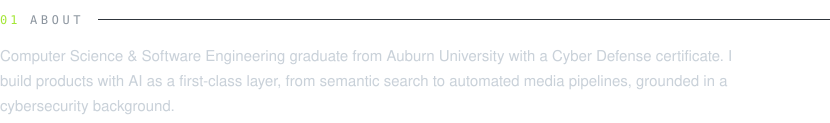
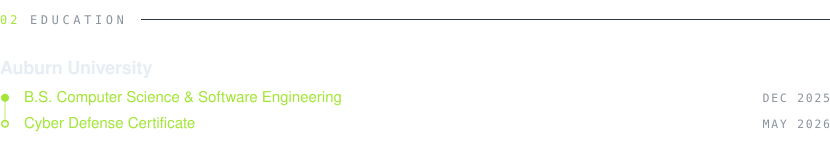

<picture>
  <source media="(prefers-color-scheme: dark)" srcset="assets/about-dark.svg">
  <source media="(prefers-color-scheme: light)" srcset="assets/about-light.svg">
  
</picture>

[rydertetreault.dev](https://rydertetreault.dev) &nbsp;·&nbsp; [LinkedIn](https://www.linkedin.com/in/ryder-tetreault) &nbsp;·&nbsp; [rydertetreault@gmail.com](mailto:rydertetreault@gmail.com)

<picture>
  <source media="(prefers-color-scheme: dark)" srcset="assets/experience-dark.svg">
  <source media="(prefers-color-scheme: light)" srcset="assets/experience-light.svg">
  
</picture>

<picture>
  <source media="(prefers-color-scheme: dark)" srcset="assets/education-dark.svg">
  <source media="(prefers-color-scheme: light)" srcset="assets/education-light.svg">
  
</picture>
